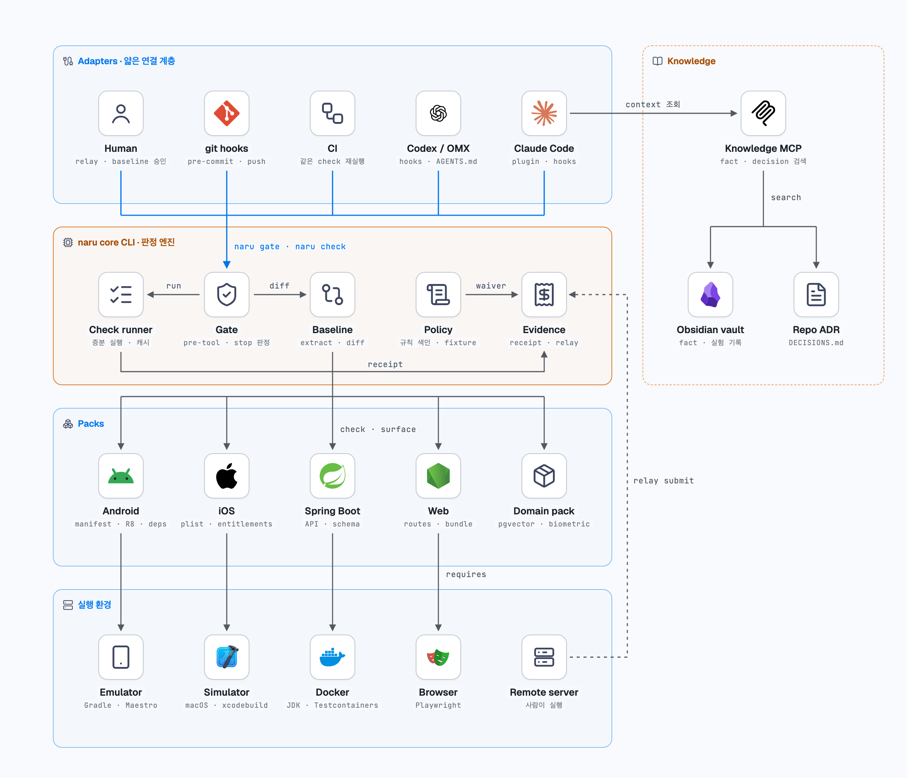
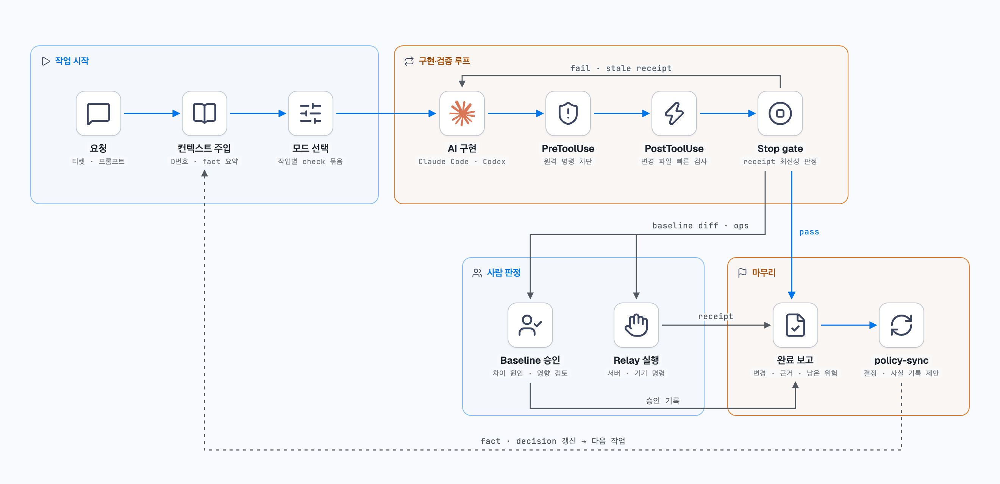

# naru

> **naru(나루)**: 강을 건너는 나루터. 변경은 사공이 확인한 뒤에만 건넌다.

`naru`는 AI 코딩 에이전트의 "완료"를 *보고*가 아니라 *검증*으로 만듭니다. 프로젝트에 필요한 check를 실행하고, 각 check가 의존하는 파일 내용에 묶인 **receipt**를 남깁니다. 필요한 check가 실행되지 않았거나, 실패했거나, 실행 뒤 파일이 바뀌었으면 에이전트가 작업을 끝내지 못하게 막습니다.

[English README](README.md)

> 상태: 초기 개발(P0). `init`, `check`, `status`, `mode`, Claude Code Stop gate가 동작합니다. baseline, 정책, relay, 플랫폼 pack은 이후 단계입니다.

## 왜 필요한가

에이전트는 테스트를 돌리지 않고 "통과했다"고 보고하거나, 통과한 뒤에도 코드를 계속 고치곤 합니다. 입력 파일에 묶인 receipt가 두 경우를 모두 잡습니다.

| 상황 | `naru status` | Stop gate |
| --- | --- | --- |
| check를 실행하지 않음 | `missing` | 차단 |
| 실행했지만 실패 | `fail` | 차단 |
| 통과한 뒤 입력 파일이 바뀜 | `stale` | 차단 |
| 현재 파일 기준으로 통과 | `pass` | 허용 |
| 입력 패턴에 맞는 파일이 하나도 없음 | `empty` | 차단 (receipt가 아무것도 증명하지 않음) |

gate는 check를 직접 실행하지 않고 receipt와 현재 파일만 비교하므로 빠릅니다.

## 구조





도식은 계획된 전체 설계입니다. P0에서는 core CLI, receipt, 모드, Stop gate를 구현했습니다.

## 설치

Go 1.23 이상이 필요합니다.

```sh
go install github.com/Chaebin-Park/naru/cmd/naru@latest
```

## 빠른 시작

```sh
cd your-repo
naru init          # .naru/config.yaml 생성 (Go, Gradle, Maven, SwiftPM, Node, Python, Rust 감지)
naru check         # 현재 모드의 check 실행, receipt 기록
naru status        # check별 pass / fail / stale / missing
```

설정 형식, 모드, 훅 연결, receipt, 종료 코드는 [README.md](README.md)와 같습니다. 요점은 다음과 같습니다.

- `inputs`는 저장소 루트 기준 glob입니다. `**`는 깊이와 상관없이 매칭하고, `**/*.go`는 루트의 파일도 포함합니다.
- git 저장소 안에서는 `.gitignore`에 걸린 파일이 해시에 들어가지 않습니다. `.naru/`와 `.git/`는 항상 제외합니다.
- check의 `run`·`workdir`·`inputs`나 전체 `exclude`를 바꿔도 receipt가 무효가 됩니다.
- `naru init`은 `inputs: ["**"]`와 스택별 제외 목록을 씁니다. 입력을 빠뜨리면 오래된 결과가 통과하므로 넓게 잡는 편이 안전합니다.
- 서브모듈·중첩 저장소는 내용까지 해시합니다. 실행 권한 비트도 해시에 들어갑니다. 매칭은 대소문자를 구분합니다.
- 모든 모드는 check를 하나 이상 요구해야 합니다.
- 설정 파일에 모르는 키가 있으면 오류를 냅니다.

## Claude Code 연결

`.claude/settings.json`에 Stop 훅을 추가합니다.

```json
{
  "hooks": {
    "Stop": [
      { "hooks": [{ "type": "command", "command": "naru gate stop" }] }
    ]
  }
}
```

차단할 때는 exit 2와 함께, 무엇이 충족되지 않았고 무엇을 실행해야 하는지 stderr로 알려 줍니다. 프로젝트 위치는 `$CLAUDE_PROJECT_DIR`을 먼저 보고 그다음 payload의 `cwd`를 봅니다. naru 프로젝트가 아니면 항상 허용하고, 설정이 잘못되었으면 차단합니다. 검증할 수 없는 상태는 통과가 아니기 때문입니다. 기본 모드가 아닌 모드로 통과하면 그 사실을 stderr에 남깁니다. 사람이 gate를 끄려면 훅 환경에 `NARU_GATE=off`를 설정합니다.

Codex 등 다른 에이전트는 네이티브 훅을 지원하기 전까지 `AGENTS.md`에 "완료 보고 전에 `naru status`를 실행하고, 0이 아니면 `naru check`로 고친 뒤 반복한다"는 지침을 넣어 연결합니다.

## 현재 한계 (P0)

- receipt와 설정이 로컬 파일이라 에이전트가 `.naru/`를 직접 고치면 gate를 넘을 수 있습니다. check 정의 변경은 receipt를 무효로 만들고 좁은 모드는 드러나지만, 막으려면 다음 단계의 PreToolUse 가드가 필요합니다.
- check는 `sh -c`로 하나씩 순서대로 실행합니다. Windows에서는 POSIX 셸이 필요하고, timeout 때 자식 프로세스까지 종료하지 못합니다.

## 라이선스

[MIT](LICENSE)
