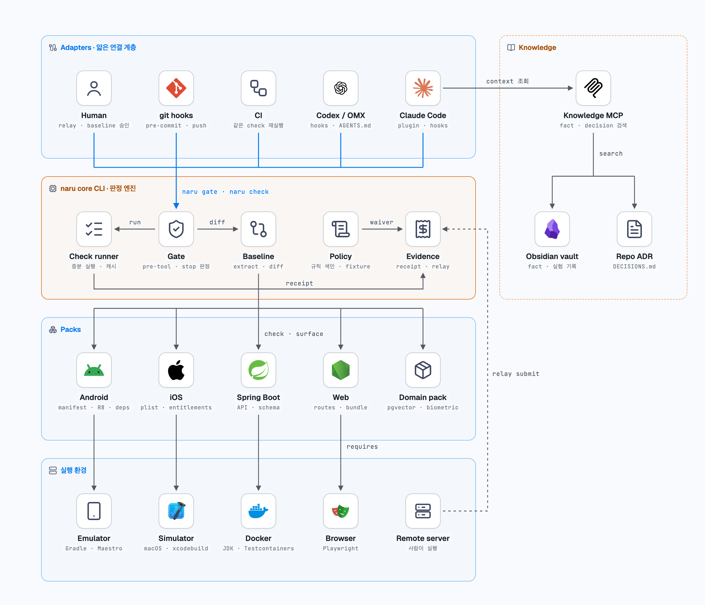
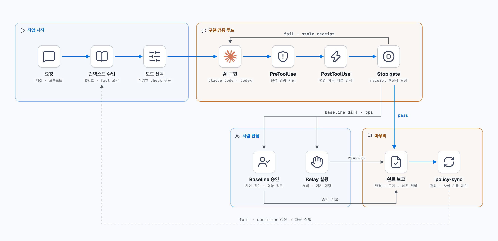

# naru

Terms: [NARU glossary](docs/glossary.md). Command names and quoted session output keep their original spelling.

> **naru** (나루) is Korean for a ferry crossing: changes cross only after the boatman checks them.

`naru` makes an AI coding agent's "done" mean *verified*, not *claimed*. It runs the checks your project requires, records a receipt (a check result tied to its inputs) for the exact content of the files each check depends on, and blocks the agent from finishing while any required check is missing, failing, or stale.

[한국어 README](README.ko.md)

> Status: early development (P0). The core loop works: `init`, `check`, `status`, `mode`, and the Claude Code Stop gate. Contract baselines, policy review, local packs and a Spring Boot example are available. Relay and further platform packs are planned.

## Why

Agents often report "tests pass" without running them, or run them and then keep editing. A receipt that is tied to the inputs closes both gaps:

| Situation | `naru status` | Stop gate |
| --- | --- | --- |
| check never ran | `missing` | blocks |
| check ran and failed | `fail` | blocks |
| check passed, then an input file changed | `stale` | blocks |
| check passed for the current files | `pass` | allows |
| a check's inputs match no files | `empty` | blocks (a receipt would prove nothing) |
| execution is active, cancelled, interrupted, incompatible, or invalid | `running` / `cancelled` / `interrupted` / `incompatible` / `invalid` | blocks |
| inputs changed during execution or cannot be verified | `input-changed` / `input-error` | blocks even when the command exits zero |

`status --json` now reports schema 2, including explicit reason codes and NOT VERIFIED presence. Corrupt evidence produces an `invalid` row and exit 1; IO errors return 70. Before/after hashing is not a snapshot and can miss A→B→A changes.

A gate decides whether an action can continue. It compares receipts with the current files. It does not run checks.

## How it fits together





The diagrams show the planned design; P0 implements the core CLI, receipts, modes, and the Stop gate. Diagram labels are partly in Korean.

## Install

Requires Go 1.23 or newer.

```sh
go install github.com/Chaebin-Park/naru/cmd/naru@latest
```

## Quick start

```sh
cd your-repo
naru init          # writes .naru/config.yaml (detects Go, Gradle, Maven, SwiftPM, Node, Python, Rust)
naru check         # runs the checks of the current mode and records receipts
naru status        # pass / fail / stale / missing for each required check
```

`.naru/config.yaml`:

```yaml
version: 1
default_mode: code
modes:
  code: [test, lint]
  docs: [links]
checks:
  test:
    run: "./gradlew test"
    inputs: ["**/*.kt", "**/*.kts", "gradle/**"]   # receipts are bound to these files
    timeout: 15m
  lint:
    run: "./gradlew detekt"
    inputs: ["**/*.kt", "config/detekt/**"]
  links:
    run: "lychee docs/"
    inputs: ["docs/**"]
exclude: ["build/**"]
```

- `inputs` are root-relative globs. `*` and `?` stay within one path segment; `**` matches any depth (`**/*.go` includes root files). Matching is case-sensitive. Braces, brackets, absolute paths, `..` and backslashes are rejected rather than silently matching nothing.
- `naru init` uses `inputs: ["**"]` plus stack-specific `exclude` entries. Narrow inputs only when a check truly ignores the rest: an over-broad input costs a re-run, a missing one lets stale work pass.
- Inside git, files ignored by `.gitignore` never count, and submodules and nested repositories are hashed by content. Outside git, or when the enclosing repository ignores the project directory, the tree is walked. `.naru/` and every `.git` are always excluded. Files are hashed by content and executable bit; symlinks by their target.
- Changing a check's `run`, `workdir` or `inputs`, or the global `exclude`, invalidates its receipt.
- Every mode must require at least one check. Unknown keys are rejected, so typos fail loudly.

## Modes

A mode is the set of checks that must pass before an agent may finish. The active mode is chosen by `--mode`, then `$NARU_MODE`, then `naru mode <name>` (stored per working copy), then `default_mode`.

```sh
naru mode docs     # a docs-only task should not need the full test suite
naru mode --clear
```

## Agent integration

### Claude Code

Put `naru` on `PATH`, then add a Stop hook and let the agent run checks in `.claude/settings.json`:

```json
{
  "permissions": {
    "allow": ["Bash(naru check:*)", "Bash(naru status:*)"]
  },
  "hooks": {
    "PreToolUse": [
      { "matcher": "Write|Edit|NotebookEdit|Bash",
        "hooks": [{ "type": "command", "command": "naru gate pre-tool" }] }
    ],
    "Stop": [
      { "hooks": [{ "type": "command", "command": "naru gate stop" }] }
    ]
  }
}
```

`naru gate pre-tool` blocks agent edits to `.naru/` (receipts, logs, config, stored mode) and agent mode changes (`naru mode <name>`), because either would let the agent satisfy the gate without doing the work. Reading `.naru/` stays allowed. This is a guard rail against shortcuts, not a security boundary; the authority is a clean `naru check` in CI, where receipts are never committed.

Use the bare `naru gate stop` command: the agent copies the command it sees in hook feedback, so an absolute path in the hook makes it call naru by that path and miss a `Bash(naru check:*)` allow rule.

When the gate blocks, it exits 2 and explains on stderr which checks are not satisfied and what to run; Claude Code feeds that back to the model and keeps working.

- The project is found from `$CLAUDE_PROJECT_DIR` first, then the hook payload's `cwd`, so an agent that `cd`s elsewhere is still gated. Outside a naru project the gate always allows.
- An invalid config blocks, because an unverifiable state is not a passing one.
- When the active mode is not `default_mode`, an allowed stop says so on stderr, so a narrowed mode is visible in the session.
- No endless loops: if the agent cannot make progress (for example `naru check` is not permitted), the same block repeats with nothing changing. After `gate.max_repeats` identical blocks in one stop chain (default 3) naru lets the agent stop and reports **NOT VERIFIED** to the user (a hook `systemMessage`) and to the model; `naru status` keeps showing a warning until a later verified stop. Any progress (an edit, a new run) resets the count. Set `gate: {max_repeats: 0}` to never give up. Failure to save/clear gate state or deliver an allowance notice blocks Stop.
- Escape hatch for humans: set `NARU_GATE=off` in the environment Claude Code runs hooks with. Every stop then reports that completion was not verified.

See [docs/verification.md](docs/verification.md) for recorded runs against real Claude Code sessions.

### Codex and others

Codex 0.166.0 exposes native Stop and PreToolUse hooks. [Connection templates and installation/removal guidance](examples/agent-hooks/README.md) describe the current hook contract and trust requirements. NARU handles Codex `apply_patch` paths separately from Claude file tools; matching `Edit|Write` alone does not translate patch input. The guard accepts plain Begin/End Patch commands; unknown wrapper syntax is blocked instead of guessed. Both tools have recorded missing/pass, stale/recheck and NOT VERIFIED observations in [verification](docs/verification.md). Review workspace trust: Claude can run project hooks while ignoring project allow rules in an untrusted directory.

For hosts without enabled hooks, add this instruction to `AGENTS.md` (instructions alone do not enforce a hook):

```md
Before reporting completion, run `naru status`. If it exits non-zero, run `naru check`, fix failures, and repeat.
```

## Git pre-push gate

Install explicitly from a naru project at the Git working tree root:

```sh
naru hooks install
naru check --mode code    # replace code with your default_mode
naru gate pre-push        # inspect the same verdict without pushing
```

The installed executable hook calls `naru gate pre-push`; `naru` must be on the hook's `PATH`. It exits 1 unless every check in `default_mode` has a fresh passing receipt and `.naru/state/unverified.json` is absent. Missing/invalid configuration, unreadable receipts, and malformed NOT VERIFIED records block. The stored mode, `NARU_MODE`, `NARU_GATE=off`, and the Stop repetition limit cannot relax this gate. Checks are not run automatically.

After a NOT VERIFIED stop, run checks for `default_mode`, then perform a verified Stop to clear the record. For a default mode named `code`, from the project root:

```sh
naru check --mode code
# Only continue when the check above succeeds:
env -u NARU_GATE -u CLAUDE_PROJECT_DIR NARU_MODE=code naru gate stop </dev/null
naru gate pre-push
```

Installation preserves an existing hook unless `--force` is supplied; force replaces only regular files. Linked worktrees share hooks, so installation can affect other working copies. Custom `core.hooksPath` settings are never changed or written through; integrate with the existing manager instead. Installation refuses inherited `GIT_DIR`, `GIT_WORK_TREE`, or `GIT_COMMON_DIR` overrides.

For [Husky](https://typicode.github.io/husky/how-to.html), add this to the existing `.husky/pre-push` hook, preserving other commands:

```sh
naru gate pre-push || exit $?
```

For [Lefthook](https://lefthook.dev/configuration/run/), merge this command into `lefthook.yml`:

```yaml
pre-push:
  commands:
    naru:
      run: naru gate pre-push
```

Humans can bypass the hook with `git push --no-verify`. This gate evaluates the **current working tree**, not every commit/ref being pushed (including pushes of other branches or tags). It is a local guard rail, not a security boundary: re-run `naru check` in a clean CI checkout of the target revision.

## Receipts

`naru check` writes schema 2 current state to `.naru/state/checks/<check>.json`, preserves previous records in `.naru/state/history/<check>/<run_id>.json`, and creates `.naru/logs/<check>-<run_id>.log`. It records running state before starting the command, prevents duplicate runs of the same check, and compares inputs before and after execution. Existing schema 1 receipts remain unchanged but require a rerun under the new policy. [Execution records and recovery](docs/execution-records.md) describes validation, JSON output, compatibility, and recovery.

## Exit codes

| Command | 0 | 1 | 2 | 64 | 70 |
| --- | --- | --- | --- | --- | --- |
| `check`, `status` | done | not done | – | usage or config error | internal error |
| `gate stop` | allow | – | block | usage error | – |
| `gate pre-push` | allow | block | – | usage error | – |
| `hooks install` | installed | refused or failed | – | usage/config error | internal error |

Log write, sync, or close errors prevent a terminal success and return an internal error; an already-published running state remains unsatisfied. New private state directories use mode 0700 and files use 0600; existing permissions are not migrated. Otherwise successful CLI commands return an error if output cannot be written.

`check` exits 130 when interrupted. A started execution records `cancelled`; earlier success stays in history and cannot satisfy the gate. On macOS/Linux, Ctrl-C sends a termination signal to the check process group. After the shell exits, naru briefly checks whether the group is absent. If children remain or the check is inconclusive, it records `owner_lost` and blocks restart pending manual recovery; interruption still exits 130. A crashed owner with leftover running state requires manual recovery before a new run; a free lock alone does not prove its children have exited.

## Known limitations (P0)

For the MVP, validation prioritizes macOS and Linux. Windows has limited support. Report runtime tests separately from builds and static checks. Mark untested behavior as unverified.

- Receipts and config are local files. `naru gate pre-tool` blocks the obvious ways an agent could edit them, but its shell detection is a heuristic; rely on CI to re-run checks from a clean checkout.
- Checks run sequentially with `sh -c`. Windows needs a POSIX shell (for example Git Bash), and a timeout there kills only the shell, not its children.
- If a check leaves a background process holding its output open, naru records the exit status and stops waiting after 5 seconds.
- Policy review is explicit; Stop/pre-push integration is pending. Relay and Android/Web packs are not implemented.

## Roadmap

P0 core loop → P1 baseline engine and Spring Boot pack → P2 Claude Code plugin, git hooks, relay → P3 Android and Web packs → P4 knowledge MCP and evals → P5 iOS pack, CI templates (GitHub Actions, Bitbucket Pipelines, Jenkins), review dashboard.

Waivers are deferred beyond the MVP. Unverified completion continues to use the existing NOT VERIFIED policy.

## License

[MIT](LICENSE)

Current behavior, receipt format, test mapping, and planned changes: [behavior baseline](docs/current-behavior.md).

Development feedback: [local static analysis and vulnerability reports](docs/development-analysis.md). Run `sh scripts/devcheck.sh` after code edits; `-watch` enables foreground change monitoring.

Task workflow: [completion and commit gate](docs/task-gate.md). A successor requires committed completion and matching verification evidence.

## Execution prerequisites

Declare optional prerequisites per check:

```yaml
checks:
  test:
    run: go test ./...
    inputs: ["**/*.go", "go.mod", "go.sum"]
    requires:
      tools: [go]
      os: [darwin, linux]
```

`requires.tools` checks executable names on PATH; `requires.os` accepts `darwin`, `linux`, and `windows`. Omit the OS list to allow any host. Names cannot contain paths, spaces, or shell expressions (maximum 256 bytes). Duplicate entries and unknown keys are errors. Every check also needs `sh`.

An unavailable prerequisite produces `not-run` and `check` exits 1 without starting the command or hashing inputs. The record identifies `missing_tool` or `unsupported_platform`; its exit code is null. Status and gates cannot accept it as passing evidence. Restore the tool or use a supported environment, then rerun the check: restoring the environment alone does not clear a saved `not-run`. Existing Stop overrides retain their NOT VERIFIED policy.

Declared prerequisites enter the input fingerprint; equivalent list ordering does not change it, and omitting prerequisites preserves earlier fingerprints. These checks do not inspect tool versions, daemon health, credentials, or service connectivity. NARU does not install tools or delegate execution to CI automatically. Availability can still change between inspection and command start.

## Surface contract foundation

The internal [surface extraction contract](docs/surface-contract.md) defines deterministic JSON output, content digests, and invalid/empty-result handling for later baseline work. It has synthetic fixtures and tests; candidate extraction/diff now use this contract; approval is separate.

## Local platform packs

Select repository-owned `packs/<directory>/pack.yaml` files through `packs` in config. Their checks use `<pack-id>.<check>` names; manifest and bundled-file changes invalidate their evidence. See [pack loading and the dummy example](docs/packs.md). Downloads, automatic activation and version probing are not performed.

## Baseline candidates

Run `naru baseline extract <surface>` to produce a verified local candidate, then `naru baseline diff <surface>` to review sorted additions, removals and changes. Both support `--json`. Extraction never overwrites the baseline; first or changed results require review. See [candidate lifecycle and exit codes](docs/baselines.md). Use the separate interactive approval command below to publish a reviewed candidate.

`naru baseline approve <surface>` reviews and publishes a candidate through terminal prompts on macOS/Linux. It rechecks inputs and the exact preview before saving the snapshot and review metadata together. Empty candidates require explicit confirmation. Legacy bare snapshots require approval before an unchanged result. See [approval and limits](docs/baselines.md#interactive-approval).

A [Spring Boot public-example pack](packs/spring-boot/README.md) now demonstrates API probes, profile-specific routes, SQL file hashes and configuration keys. It requires Java/Maven/Python and manual activation. Its build check does not automatically enforce approved surface equality.

An [Android public-example pack](packs/android/README.md) builds a Java app and local library, then exports the real debug merged manifest and resolved dependency graph. It requires the pinned Android/Gradle/JDK toolchain and manual activation. Permission, component exported-state and dependency changes can be reviewed with baseline commands; no emulator or device is used. See the [verification scope](docs/android-verification.md).

## Policy review

`naru policy list` validates `.naru/policy.yml`; `naru policy test [rule-id]` runs bound pass/violation fixtures. `naru policy check` refreshes complete findings and separates known, new and resolved violations. Known violations warn; new violations block. Missing or incomplete tool output cannot count as resolved.

Use terminal-only `naru policy bootstrap` once to approve the initial known set, then `naru policy approve` for reductions. Both recheck the reviewed candidate and current inputs. Approval cannot add violations or migrate changed rule definitions. Policy storage is separate from contract baselines, and these commands do not implicitly add Stop/pre-push requirements. See [policy format, commands and limitations](docs/policy.md).

## Human-relayed checks

Use `naru relay new --target 'test workstation' --artifact execution.log CHECK` when a person must run a check elsewhere, then `naru relay submit --file submission.json PACKET_ID` to validate the result and artifact hashes. Issuing a request replaces that check's current evidence with pending evidence. Valid `human-relayed` success can satisfy local Stop/pre-push; CI must execute `naru check --evidence ci` independently. NARU neither runs remote commands nor authenticates the person's claim. See [request, submission, expiry and trust limits](docs/relay.md).
